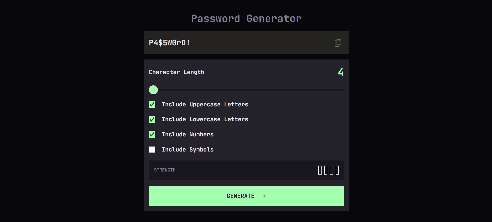

# Password Generator App

A responsive password generator built with HTML, CSS, and JavaScript.
This project is a solution to the Password Generator App challenge
on Frontend Mentor.

## Features

- Choose a password length between 4 and 20 characters.
- Include uppercase letters, lowercase letters, numbers, and symbols.
- Guarantee at least one character from each selected type.
- Shuffle character positions using the Fisher–Yates algorithm.
- Generate random values using the Web Crypto API.
- Display a basic password strength estimate.
- Copy passwords to the clipboard with visual feedback.
- Navigate the interface using a keyboard.
- Use the app on mobile and desktop screens.

## Built with

- Semantic HTML
- CSS Flexbox and Grid
- Responsive CSS media queries
- Vanilla JavaScript
- Web Crypto API
- Clipboard API
- JetBrains Mono font

## Run locally

1. Clone the repository:

   git clone https://github.com/felipesbelphman-web/password-generator-app.git

2. Open the project in VS Code.
3. Open starter-code/index.html using the Live Server extension.

## What I learned

Through this project, I practiced DOM manipulation, form events,
input validation, responsive layouts, and keyboard accessibility.

I also learned how to generate random values with crypto.getRandomValues(),
guarantee selected character types, and shuffle characters using
the Fisher–Yates algorithm.

## Strength indicator

The strength indicator uses a simple rule based on password length
and the number of character types present. It is an educational
estimate, not a comprehensive password security assessment.

## Author

Felipe Belphman

- GitHub: https://github.com/felipesbelphman-web
- Portfolio: https://felipesbelphman-web.github.io/portfolio-felipe-belphman/

## Acknowledgments

Design challenge by Frontend Mentor:
https://www.frontendmentor.io